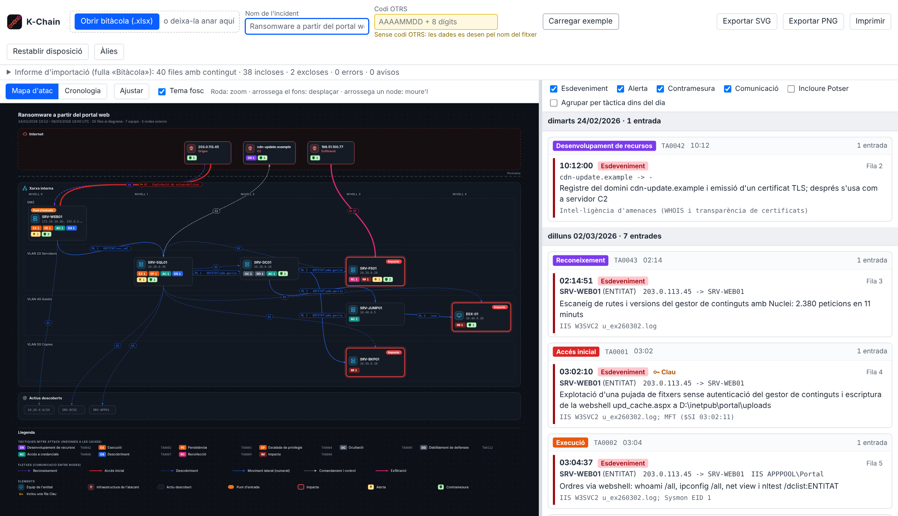
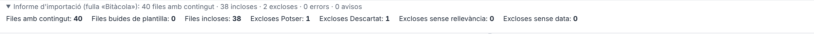
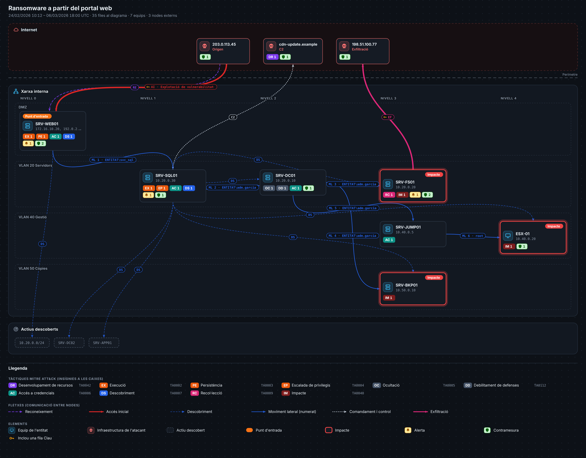
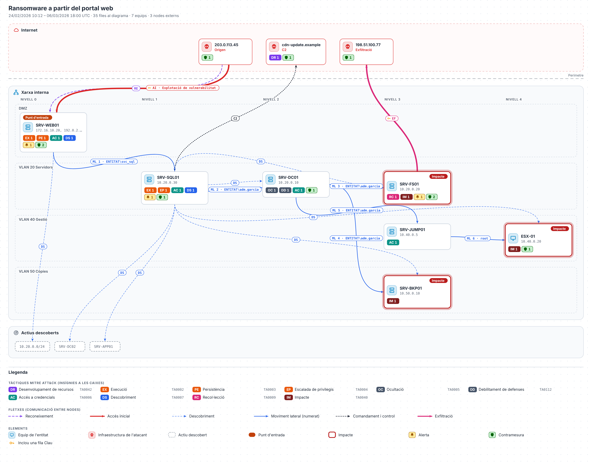
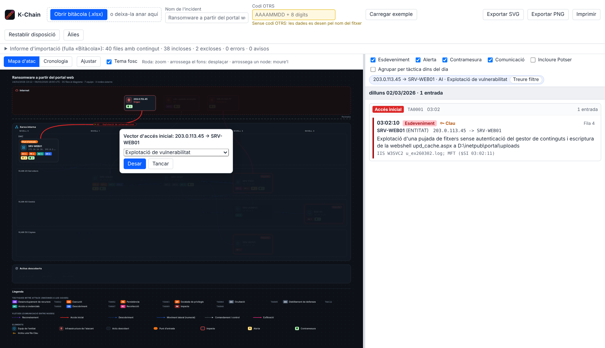
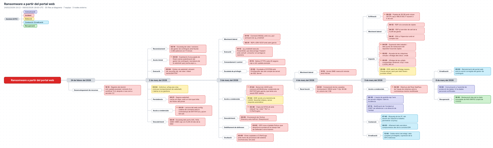
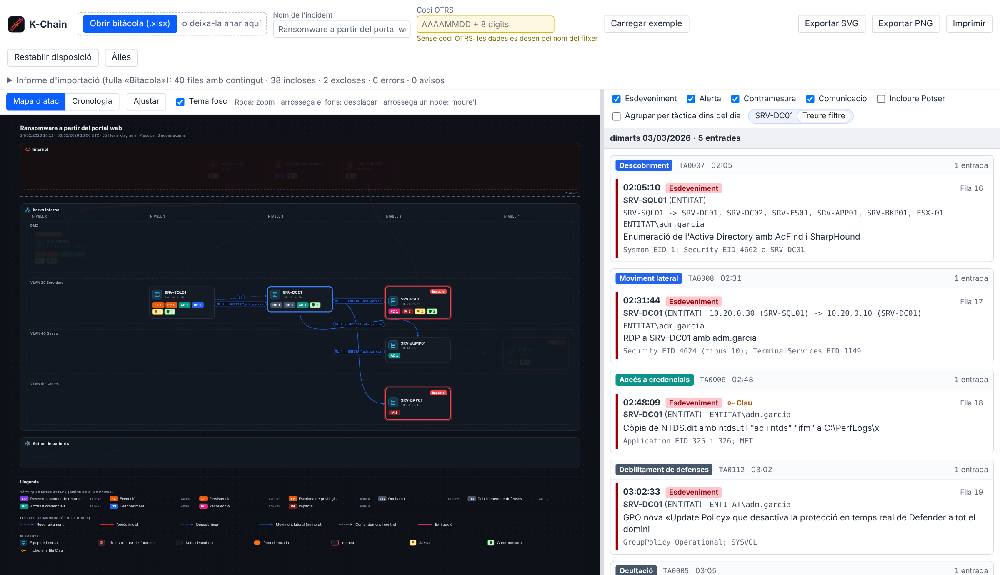
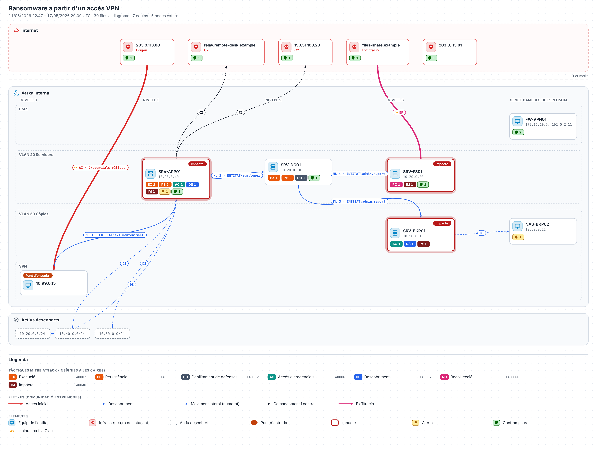

<p align="center">
  <picture>
    <source media="(prefers-color-scheme: dark)" srcset="docs/logo/k-chain-logo-dark.svg">
    
  </picture>
</p>

# K-Chain

K-Chain converteix la bitàcola d'un incident (l'Excel que l'equip de resposta omple durant la investigació) en un mapa de la cadena d'atac, una cronologia i una línia temporal enllaçades. És un únic fitxer HTML que s'obre amb doble clic, funciona sense connexió i no envia res fora de l'equip: l'Excel es llegeix i es processa dins del navegador.



Totes les captures i bitàcoles d'aquest repositori són fictícies.

## Posada en marxa

1. Descarrega `k-chain.html` i obre'l amb doble clic a Edge, Chrome o Firefox.
2. Prem "Obrir bitàcola (.xlsx)" o arrossega l'Excel a la finestra. Per provar-la sense dades pròpies, prem "Carregar exemple" o obre qualsevol fitxer de la carpeta `exemples/`.
3. Escriu el nom de l'incident i el Codi OTRS. Tots dos surten a la capçalera del diagrama i al nom dels fitxers exportats.

No cal instal·lar res ni aixecar cap servidor. Una política Content-Security-Policy dins del mateix fitxer bloqueja qualsevol petició de xarxa, de manera que l'evidència no surt mai de l'estació.

## Com llegeix la bitàcola

K-Chain llegeix la fulla `Bitàcola` i, si hi són, les fulles `Màquines` i `Xarxes`. Localitza les columnes pel nom i no per la posició, així que accepta les diferents versions de la plantilla ("Time (UTC)" o "Timestamp (UTC)", l'errata "Font Evidèncie", noms en castellà o en anglès).

Abans de dibuixar una fila hi aplica aquests filtres:

- **Rellevància:** només hi entren Clau i Confirmat. Les files Potser hi entren si s'activa "Incloure Potser" i es dibuixen atenuades. Les Descartat no hi entren mai. Una fila amb la rellevància buida queda fora i es marca com a error, perquè cap fila desaparegui sense que l'analista ho vegi.
- **Data:** s'interpreta sempre en UTC. Una fila sense data vàlida queda fora amb un avís.
- **Tipus:** Esdeveniment (acció de l'atacant), Alerta (detecció), Contramesura (acció de resposta) o Comunicació (avisos, notificacions, reunions de gestió).
- **Tàctica:** es reconeix l'etiqueta de la plantilla, la traducció al castellà o a l'anglès, l'identificador TA de MITRE ATT&CK o un valor amb alguna errata petita. El catàleg segueix les 15 tàctiques de la matriu Enterprise actual: Reconeixement (TA0043), Desenvolupament de recursos (TA0042), Accés inicial (TA0001), Execució (TA0002), Persistència (TA0003), Escalada de privilegis (TA0004), Ocultació (Stealth, TA0005), Debilitament de defenses (Defense Impairment, TA0112), Accés a credencials (TA0006), Descobriment (TA0007), Moviment lateral (TA0008), Recol·lecció (TA0009), Comandament i control (TA0011), Exfiltració (TA0010) i Impacte (TA0040). A les contramesures, la Tàctica indica la fase: Contenció, Erradicació, Recuperació, Disrupció o Remediació.
- **Evasió de defenses:** ATT&CK ja no la té, es va dividir en Ocultació i Debilitament de defenses. Com que les plantilles antigues encara l'ofereixen, una fila amb aquest valor s'assigna a Ocultació (TA0005) i l'informe avisa perquè l'analista la passi a Debilitament de defenses si el que descriu és desactivar o degradar defenses.

L'informe d'importació resumeix quantes files s'han llegit, quantes hi entren i per què s'ha exclòs cadascuna.



Una mateixa màquina sol sortir a la bitàcola pel nom en una columna i per la IP en una altra. K-Chain la redueix a un únic node amb la fulla Màquines, els àlies que escrigui l'analista i les parelles del tipus `10.20.0.20 (SRV-FS01)` que trobi a les files. També neteja formes com `ENTITAT\SRV-FS01`, `SRV-FS01$`, `10.20.0.20:445` o un FQDN intern.

## El mapa d'atac

El diagrama es llegeix de dalt a baix i d'esquerra a dreta. A dalt hi ha Internet amb la infraestructura de l'atacant i, sota el perímetre, la xarxa de l'entitat. Les columnes de la xarxa interna són nivells de propagació: al nivell 0 hi ha els equips per on va entrar l'atacant, i cada moviment lateral porta al nivell següent. A baix surten els actius que l'atacant va descobrir però no va arribar a tocar.



Només les tàctiques que comuniquen nodes entre si es dibuixen com a fletxes: Reconeixement, Accés inicial, Descobriment, Moviment lateral (numerat per ordre cronològic), C2 i Exfiltració. La resta (Execució, Persistència, Escalada de privilegis, Accés a credencials, Recol·lecció, Impacte...) surten com a insígnies a la caixa de l'equip on van passar, amb el codi de dues lletres i el nombre de files. Desenvolupament de recursos es queda com a insígnia al node de l'atacant. Les alertes es marquen amb una campana i les contramesures amb un escut.

Els equips xifrats o destruïts porten la vora vermella i la cinta "Impacte", i els punts d'entrada l'etiqueta "Punt d'entrada". Les fletxes que inclouen alguna fila Clau són més gruixudes i porten una clau. Cada tàctica s'identifica pel codi a més del color, perquè el diagrama s'entengui també en blanc i negre.

En pantalla el tema fosc és el predeterminat. El clar està pensat per enganxar el diagrama en informes tècnics o imprimir-lo.



### Xarxes i VLAN

Cada xarxa es dibuixa com una caixa dins de la xarxa interna, de manera que un moviment lateral entre xarxes es veu creuant-ne la vora. Les xarxes es poden definir de dues maneres:

- A la fulla `Xarxes` de l'Excel, una per fila, amb el nom i els rangs CIDR, IP o equips separats per coma. La plantilla ja la porta.
- A "Àlies", amb el format `Nom = rangs o equips`. Es desen per incident i tenen prioritat sobre les del fitxer amb el mateix nom.

Una IP pública de l'entitat (la DMZ o la VPN) es tracta com a interna si cau dins d'una d'aquestes xarxes.

### Vector d'accés inicial

En prémer una fletxa d'Accés inicial apareix un selector per indicar el vector: VPN, Explotació de vulnerabilitat, Correu de pesca, Credencials vàlides, RDP exposat, Cadena de subministrament, Dispositiu extraïble o un altre escrit a mà. El vector surt a l'etiqueta de la fletxa i es desa amb l'incident. Si la bitàcola té la columna `Vector`, el seu valor es fa servir com a punt de partida.



## Cronologia

El selector "Mapa d'atac / Cronologia" del tauler esquerre canvia el diagrama per una cronologia horitzontal en forma de mapa mental. A l'esquerra hi ha el nom de l'incident i, al llarg de l'eix, un node per dia UTC. De cada dia surten branques per tàctica i, a cada branca, les accions amb l'hora i la descripció. Les branques es llegeixen en ordre cronològic de dalt a baix: la primera meitat del dia queda damunt de l'eix i la segona a sota.

El color de cada caixa indica la categoria segons el Tipus de la fila: Comunicació (lila), Incident per a Esdeveniment (vermell), Detecció per a Alerta (groc), Contenció i Erradicació per a Contramesura (blau) i Recuperació per a les contramesures amb la fase Recuperació (verd). Les files Clau porten la clau i les Potser, si s'inclouen, la vora discontínua. Les files de Comunicació només surten a la cronologia i a la línia temporal, no al mapa.



Si l'incident dura més de 31 dies o té més de 12 dies diferents, la cronologia s'agrupa per mes per no créixer a l'ample: cada mes és un node de l'eix i les branques porten el dia i la tàctica ("Dia 10 - Execució").

En passar el ratolí per una caixa es veu la fila completa. En prémer-la, se selecciona l'entrada a la línia temporal de text i, a l'inrevés, en prémer una entrada de la línia temporal la cronologia se centra a la seva caixa. S'exporta a PNG o SVG igual que el mapa, amb el sufix `_cronologia`.

## Línia temporal i interacció

La línia temporal de la dreta narra la bitàcola fila a fila, agrupada per dia UTC i, dins de cada dia, en blocs de files consecutives amb la mateixa tàctica. Cada entrada mostra l'hora, el tipus amb els colors de la plantilla, l'equip, l'origen i el destí amb el nom resolt, l'usuari, la descripció tal com és a l'Excel i la font de l'evidència.

Les vistes estan enllaçades:

- En passar el ratolí per una caixa, una fletxa o una insígnia apareixen les files que l'expliquen.
- En prémer-la, la resta del diagrama s'amaga i la línia temporal es filtra a aquestes files. Prémer el fons o "Treure filtre" ho torna tot a l'estat normal.
- En prémer una entrada de la línia temporal se'n ressalten els nodes i les fletxes al diagrama.



Els nodes es poden arrossegar per retocar la disposició. La posició, els àlies, les xarxes i els vectors es desen al navegador associats al Codi OTRS (o al nom del fitxer si encara no hi ha codi), i es recuperen en tornar a obrir la mateixa bitàcola encara que hagi crescut.

## Exportar

"Exportar PNG" i "Exportar SVG" generen la vista activa (mapa o cronologia) sencera, amb capçalera i llegenda, sigui quin sigui el zoom en pantalla. El fitxer es diu `<Codi OTRS>_<Nom de l'incident>_diagrama` o `_cronologia`. "Imprimir" treu la vista activa en tema clar seguida de la línia temporal.

## Bitàcoles d'exemple

La carpeta `exemples/` té sis bitàcoles fictícies que comparteixen la mateixa xarxa: una DMZ amb el portal web, el concentrador VPN i el correu; la VLAN 20 de servidors; la VLAN 30 d'usuaris; la VLAN 40 de gestió amb l'hipervisor; la VLAN 50 de còpies amb un NAS immutable, i el rang de la VPN. Cada escenari hi és en dues versions: la intrusió completa fins al ransomware i la mateixa intrusió aturada abans de l'impacte.

| Fitxer | Escenari |
|---|---|
| `01_web_webshell_ransomware.xlsx` | Explotació del portal web de la DMZ, webshell, credencials del SQL al `web.config`, moviment lateral fins al domini, exfiltració, supressió de còpies i xifratge de servidors i de l'hipervisor. És l'exemple que es carrega amb "Carregar exemple". |
| `02_web_webshell_intrusio.xlsx` | La mateixa entrada, detectada pel SOC durant l'enumeració de l'Active Directory i continguda. |
| `03_vpn_rat_ransomware.xlsx` | Credencials vàlides d'un proveïdor a la VPN sense MFA, AnyDesk i un proxy SOCKS com a persistència, compte d'administrador nou, exfiltració al núvol, desinstal·lació de l'EDR i xifratge. El NAS immutable salva les còpies. |
| `04_vpn_rat_intrusio.xlsx` | La mateixa entrada, aturada en la fase d'accés a credencials. |
| `05_pesca_kerberoasting_ransomware.xlsx` | Correu de pesca amb una ISO, implant amb balisa HTTPS, Kerberoasting d'un compte de servei, abús de Backup Operators, DCSync i desplegament del xifrador per GPO. |
| `06_pesca_kerberoasting_intrusio.xlsx` | La mateixa entrada, aturada quan el SOC relaciona l'alerta de Kerberoasting amb la balisa. |



Les IP de l'entitat i de l'atacant són de documentació (192.0.2.0/24, 198.51.100.0/24 i 203.0.113.0/24), els dominis acaben en `.example` i l'entitat es diu ENTITAT.

## Plantilla de bitàcola

`plantilla/Bitacola_plantilla.xlsx` és una bitàcola buida, a punt per fer servir, amb l'estructura de la plantilla de l'equip i els camps al dia:

- Columnes de la fulla Bitàcola: Tipus, Time (UTC), Host, Domini, Source, Destination, Usuari, Rellevància, Tàctica, Descripció, Font Evidència i Vector.
- Llistes desplegables (a la fulla oculta Llegenda) amb els quatre tipus, les 15 tàctiques actuals d'ATT&CK més les fases de resposta, i els vectors d'accés inicial. La llista de Vector admet valors escrits a mà.
- Cada fulla és una taula d'Excel amb 500 files preparades (s'amplia sola en escriure a sota), capçalera fixa i filtres. Cada columna té el seu format: Time (UTC) com a data i hora `dd/mm/aaaa hh:mm:ss`; Host, Source, Destination, Usuari i Font Evidència en lletra monoespaiada; Descripció amb ajust de text, i colors condicionals a Tipus i Rellevància.
- Fulles Màquines, Xarxes, IOC i Evidències, i les ocultes Entitats i "Assets en poder de l'atacant", com a la plantilla original.
- Una fulla Instruccions amb el que va a cada columna i una fila d'exemple.

## Requisits de l'Excel

- Format `.xlsx` sense contrasenya. Un `.xls` antic s'ha de desar abans com a `.xlsx`.
- Columnes obligatòries: Tipus, Time (UTC), Tàctica i Descripció. La resta (Host, Domini, Source, Destination, Usuari, Rellevància, Font Evidència, Vector) són opcionals.
- Source i Destination admeten diversos valors separats per coma, punt i coma o salt de línia.
- Si es fa servir una plantilla antiga, cal afegir Comunicació a la llista de Tipus de la fulla Llegenda per poder triar-la al desplegable.

## Autotest

Si obres el fitxer amb `?selftest` al final de la ruta (`k-chain.html?selftest`) s'executen les proves internes: lectura de l'Excel, regles de la bitàcola, model del diagrama, cronologia i línia temporal amb els valors esperats d'una bitàcola de prova. També mesura el temps amb una bitàcola generada de 2.000 files, que es processa en uns 200 ms.

## Estructura del repositori

```
k-chain.html                        l'eina (un únic fitxer)
exemples/                           sis bitàcoles fictícies d'escenaris d'atac
plantilla/Bitacola_plantilla.xlsx   bitàcola buida per fer servir en un incident
docs/img/                           captures d'aquest README
docs/logo/                          logo en SVG i PNG (icona, versió clara i fosca, imatge social)
```

El logo representa la cadena de l'atac: tres nodes units per baules amb els colors que el diagrama fa servir per a Entrada, Control de l'equip i Objectius.

Les bitàcoles reals no s'han de pujar al repositori. El `.gitignore` exclou qualsevol `.xlsx` llevat dels exemples i la plantilla.
